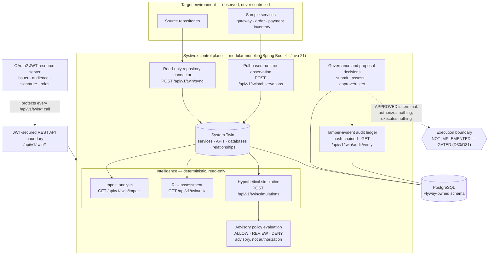

# Systivex

**Agentic software-system twin & change-intelligence control plane.**

[](https://github.com/soubhagya-behera/systivex/actions/workflows/backend-ci.yml)
[](https://adoptium.net/)
[](LICENSE)

Systivex builds a living **System Twin** of a software system — its code, architecture,
data flows, and runtime behavior — so proposed changes can be **impact-analysed,
risk-assessed, simulated, policy-evaluated, and governed through approval** before
anything is asked to touch a real system.

It is deliberately a **control plane for safe engineering action**, not a point tool. It
grounds reasoning in an authoritative model of the system and routes every consequential
decision through explicit, auditable governance.

> **Controlled execution is not implemented.** An `APPROVED` proposal is a terminal
> permission record — it authorizes nothing by itself and executes nothing. Acting on an
> approval is a human step outside the system, and remains gated by the feasibility
> decision recorded in [`DECISIONS.md`](DECISIONS.md) (D30/D31). There is no execution
> endpoint, no executor role, and no target actuator in this repository.

## Architecture at a glance



The **control plane** is a modular monolith that owns the twin model, the intelligence
modules, policy evaluation, governance, and the audit log. The **target environment** is a
set of independently deployable sample services Systivex can observe but does not control.
**Consequential actions cross the policy/execution boundary — and the execution side of
that boundary is intentionally not built.**

See [`ARCHITECTURE.md`](ARCHITECTURE.md) for the deterministic-vs-advisory distinction and
the trust boundaries, and [`THREAT_MODEL.md`](THREAT_MODEL.md) for the security principles.

## What Systivex is

- A **software-system twin**: a persisted graph of services, APIs, databases, tables, and
  the relationships between them, built by a read-only repository connector.
- A **change-intelligence workspace**: deterministic impact analysis, ordinal risk
  assessment, and *hypothetical* before/after simulation of a proposed change.
- A **governance and audit layer**: governed change proposals with assessment, amendment,
  approval/rejection, and a tamper-evident audit chain.

## What Systivex is not

- Not an AI code reviewer, an SRE chatbot, a generic LLM wrapper, or a chat assistant over
  logs.
- Not an execution engine or an autonomous agent. Nothing in this repository changes a
  target system, and no agent exists.

## Capabilities

| Capability | Surface | Status |
| --- | --- | --- |
| System-twin persistence and REST | `.../twin` | Implemented & tested |
| Repository observation (read-only sync) | `POST /api/v1/twin/sync` | Implemented & tested |
| Change-impact analysis | `GET /api/v1/twin/impact` | Implemented & tested |
| Change-risk assessment | `GET /api/v1/twin/risk` | Implemented & tested |
| Hypothetical change simulation | `POST /api/v1/twin/simulations` | Implemented & tested |
| Advisory policy evaluation | `POST /api/v1/twin/policy-evaluations` | Implemented & tested |
| Governed proposals | `.../proposal` | Implemented & tested |
| Tamper-evident audit | `GET /api/v1/twin/audit/verify` | Implemented & tested |
| Control-plane authentication | every `/api/v1/twin/*` call | Implemented & tested |
| Runtime observation (health + counters) | `POST /api/v1/twin/observations` | Implemented & tested |
| Controlled execution | — | **Design only — gated (D30/D31)** |
| Frontend / operator console | — | Planned, not implemented |
| Agent orchestration, post-change verification, Git integration | — | Planned, not implemented |

The deterministic capabilities — impact analysis, risk assessment, and hypothetical
simulation — are independent of any model and are not advisory. **Policy evaluation is
advisory and never authorization. Simulation is hypothetical and never execution.** The
backend is under active local development, is **not production-ready**, and is not
deployed anywhere by this project. See [`PROJECT_STATUS.md`](PROJECT_STATUS.md) for the
phase-by-phase record of what exists.

## Authentication

The entire `/api/v1/twin/*` surface requires a **JWT bearer token**; the control plane is
an OAuth2 **resource server** and validates issuer, audience, signature, expiry, and
`nbf`, with allowlist-only role mapping.

- Roles: `TWIN_READ`, `TWIN_ANALYZE`, `TWIN_OPERATOR`, `TWIN_ADMIN`, `TWIN_APPROVER`.
  `TWIN_ADMIN` inherits the first three but never `TWIN_APPROVER`.
- Configuration is fail-closed via `systivex.security.jwt.*`; a trusted `issuer-uri` is
  **mandatory** and there is no security-off mode.
- There is **no login flow, no bundled identity provider, and no default credentials** in
  this repository. You must configure a trusted issuer and obtain a token from it.
- Automated tests use locally generated signing keys only; **live identity-provider
  verification is still pending** a configured trusted issuer and is not claimed.

Configuration details are in [`DEVELOPMENT.md`](DEVELOPMENT.md).

## Quick start

Prerequisite: **JDK 21** (`JAVA_HOME` must point at a JDK 21 installation) and, for the
tests, a running **Docker** daemon (Testcontainers PostgreSQL). PostgreSQL 18 is required
only to run the application locally.

```powershell
cd backend
$env:JAVA_HOME="C:\Program Files\Java\jdk-21.0.10"
$env:Path="C:\Program Files\Java\jdk-21.0.10\bin;" + $env:Path
./mvnw clean test        # requires Docker (Testcontainers PostgreSQL)
./mvnw package -DskipTests
```

Running the application also requires a trusted JWT issuer, a local PostgreSQL database,
and the `SYSTIVEX_DB_PASSWORD` environment variable. Full instructions, including
authentication configuration, are in [`DEVELOPMENT.md`](DEVELOPMENT.md).

## Repository layout

```text
systivex/
├── backend/                 # Spring Boot control plane (Java 21, Maven wrapper)
│   │   ├── .../twin/        # twin model, persistence, REST
│   │   ├── .../observation/ # repo connector + POST /api/v1/twin/sync
│   │   ├── .../intelligence/# impact, risk, hypothetical simulation
│   │   ├── .../telemetry/   # pull-based runtime annotation
│   │   ├── .../policy/      # advisory policy evaluation
│   │   ├── .../proposal/    # governed proposals + tamper-evident audit
│   │   └── .../security/    # JWT resource server, role policy
│   └── target-services/     # sample target environment (gateway/order/payment/inventory)
├── observability/           # local collector + Prometheus + Loki + Grafana (telemetry only)
├── ARCHITECTURE.md          # target architecture + current status
├── DEVELOPMENT.md           # build, test, run, configure
├── PROJECT_STATUS.md        # phase-by-phase record of what exists
├── DECISIONS.md             # architectural decisions (D29–D32 relevant to governance/licensing)
├── THREAT_MODEL.md          # trust principles
├── CONTRIBUTING.md          # how to contribute
├── CODE_OF_CONDUCT.md       # contributor code of conduct
├── SECURITY.md              # how to report a vulnerability
└── LICENSE                  # Apache License 2.0
```

## Contributing

Contributions are welcome. Start with [`CONTRIBUTING.md`](CONTRIBUTING.md) for the
architecture overview, prerequisites, verified build/test commands, and review
expectations. All participation is covered by
[`CODE_OF_CONDUCT.md`](CODE_OF_CONDUCT.md).

## Security

Please report vulnerabilities privately — **do not open a public issue**. See
[`SECURITY.md`](SECURITY.md) for the supported reporting route.

## Project rules (binding)

- Java 21, Spring Boot 4.1.1, Maven (wrapper).
- Modular monolith for the Systivex control plane; microservices are reserved for the
  target environment.
- PostgreSQL as primary persistence (Flyway-owned schema, Hibernate validates only).
- REST initially; no Kafka, RabbitMQ, Kubernetes, WebSockets, vector databases, MCP,
  multi-agent architecture, or cloud infrastructure at this stage.
- When the frontend lands, it follows the repository convention: **React/Vite with
  JavaScript, not TypeScript**, unless a future recorded decision changes it.
- Proposed execution capabilities, authentication changes, security-sensitive behavior,
  and new infrastructure require careful review and must not bypass existing decisions.

## License

Systivex is licensed under the **Apache License, Version 2.0**. The full license text is in
[`LICENSE`](LICENSE).

Copyright 2026 Soubhagya Kumar Behera.

Unless required by applicable law or agreed to in writing, software distributed under the
License is distributed on an "AS IS" BASIS, WITHOUT WARRANTIES OR CONDITIONS OF ANY KIND.
This is a summary; the [`LICENSE`](LICENSE) file governs. It is not legal advice.
